# A6 – [Bracket Drawing]

## Objective
- Create a parametric model and a detailed engineering drawing from the project A5 sketch and dimensions.

## Analyze
Before creating sketches, all dimensions calculated from the stress analysis of the bracket were made to be global variables with respect to each feature. All dimensions used were from the stress analysis of the part.

### Sketches & Features

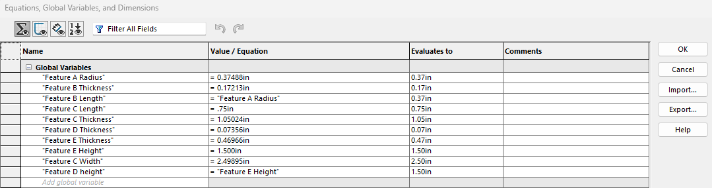

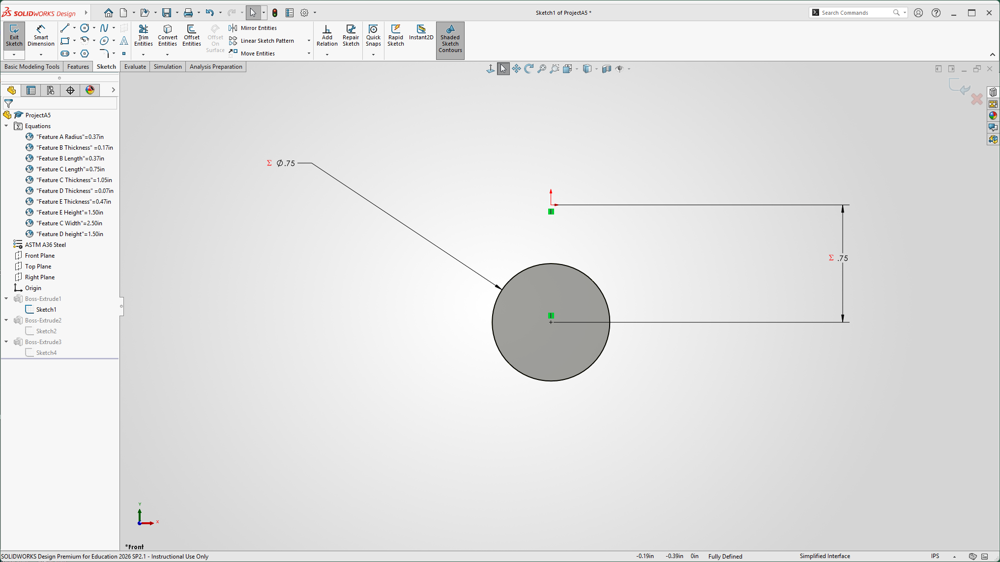

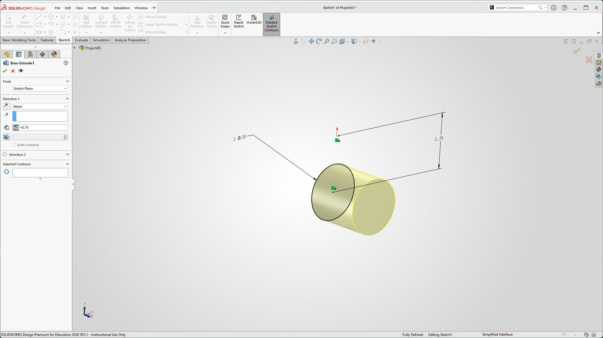

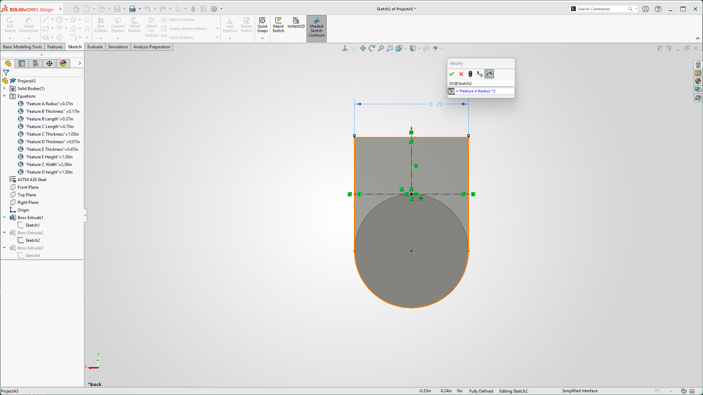

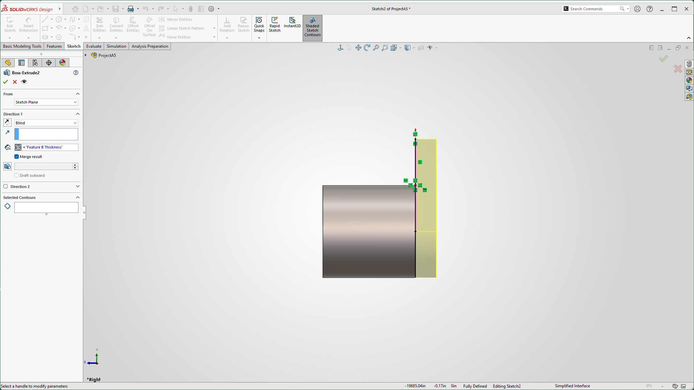

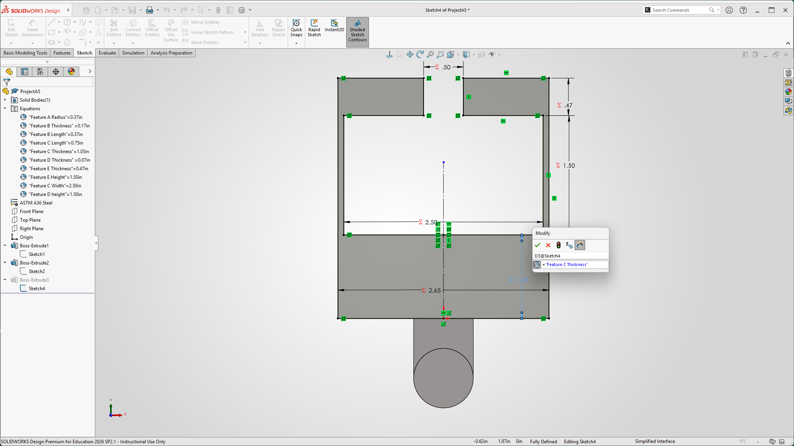

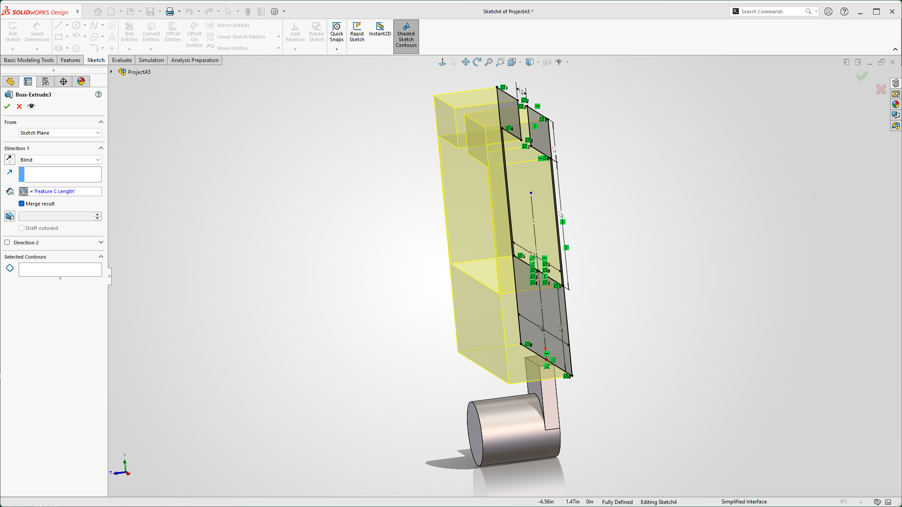

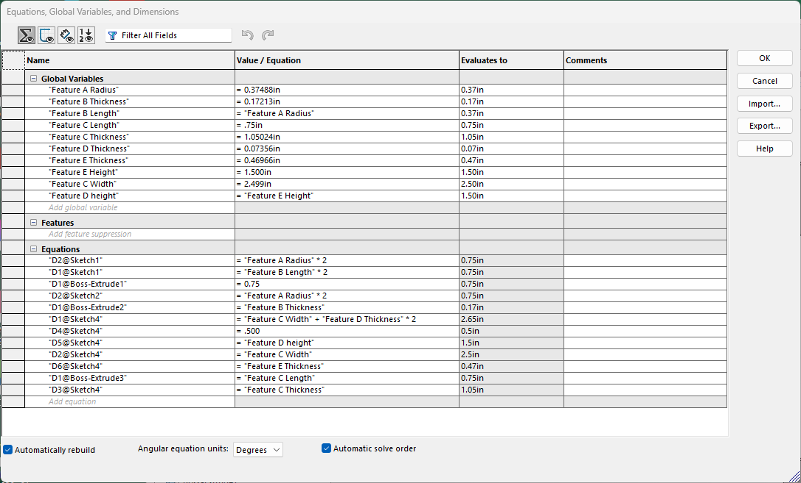

### Bracket Drawing

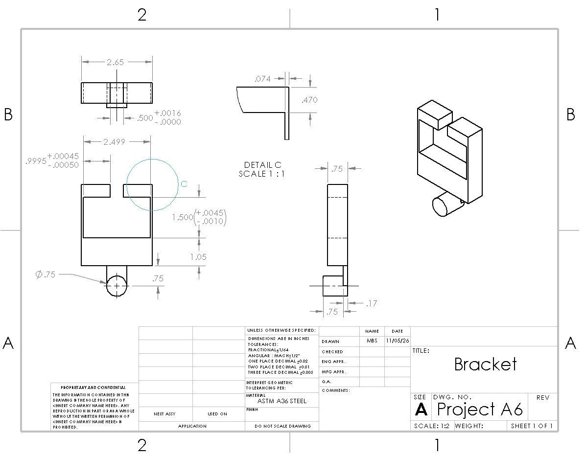

### Link 
All link dimensions were taken from stress calculations, with only one dimension modeled parametrically.

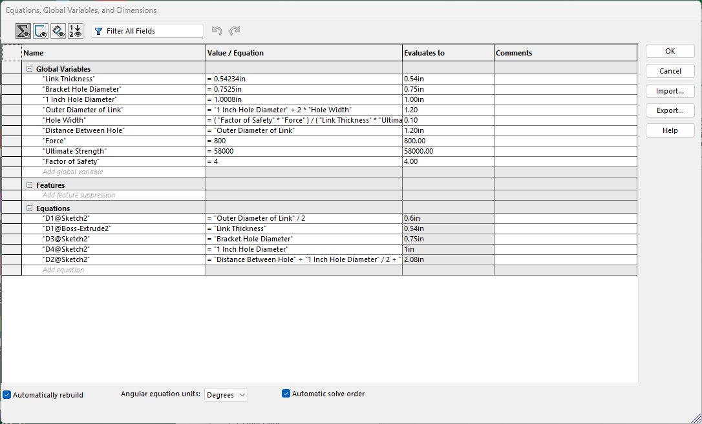

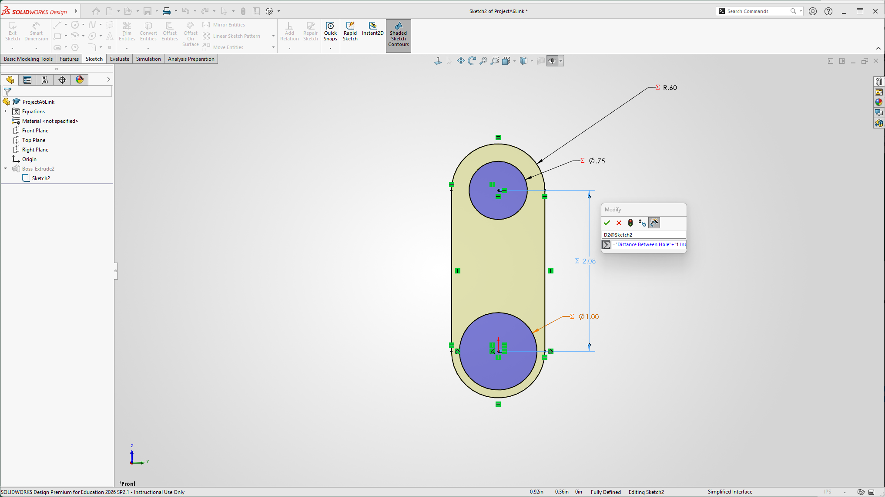

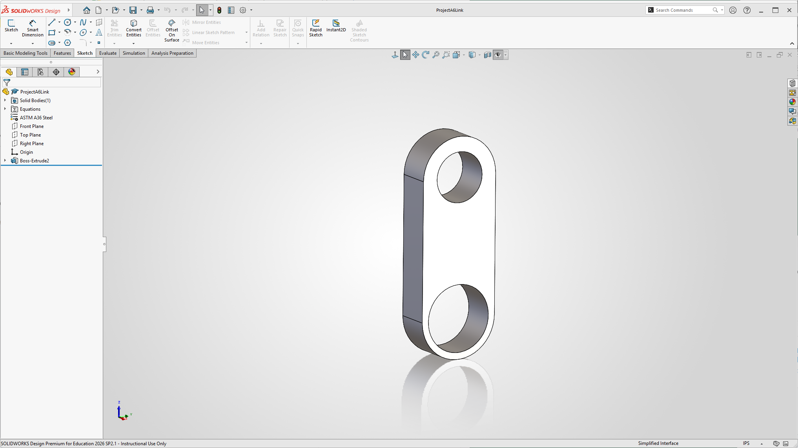

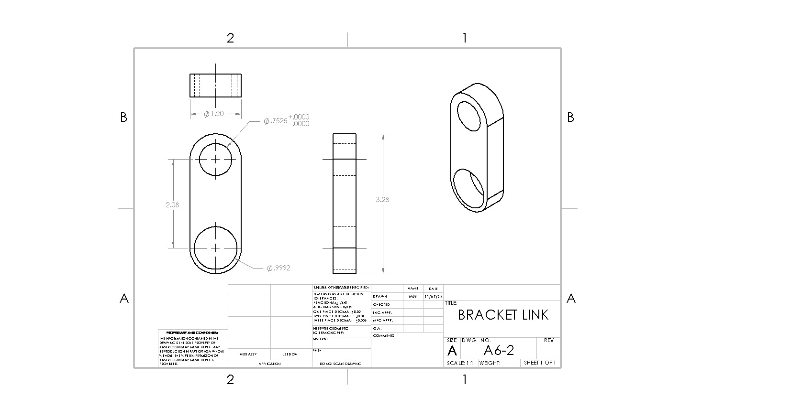

## Decide

### Bracket Drawing
Tolerances applied to critical features are done to X.XXX or X.XXXX units, because of the required clearances of each fit. However, feature D and E's thickness is done to X.XXX to meet stress requirements. Other non-critical features are done to X.XX to minimize costs where possible. 

### Link Drawing
Dimensions of the 1-inch hole were changed to ensure a proper fit for FN1. The dimension of the hole was made with the assumption that the minimum shaft diameter is 1.0000". 

## Communicate

Initially, all global variables were set to the values from the hand calculations. All feature dimension values were assigned from equations derived by hand, and I added Force, Ultimate Strength, and Factor of Safety values. After correction, the only value that changed from initial calculations was the thickness of Feature B. No problems occurred after correction, and both the model and drawing reflected the new value after changing it. Below are the corrected values, equations, and drawing.

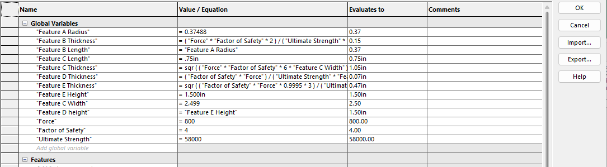

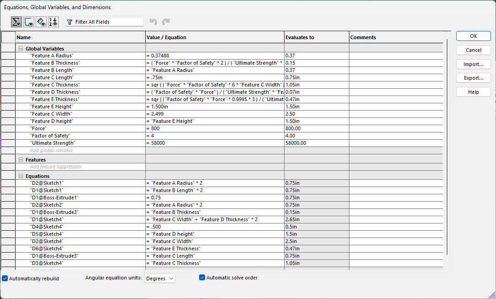

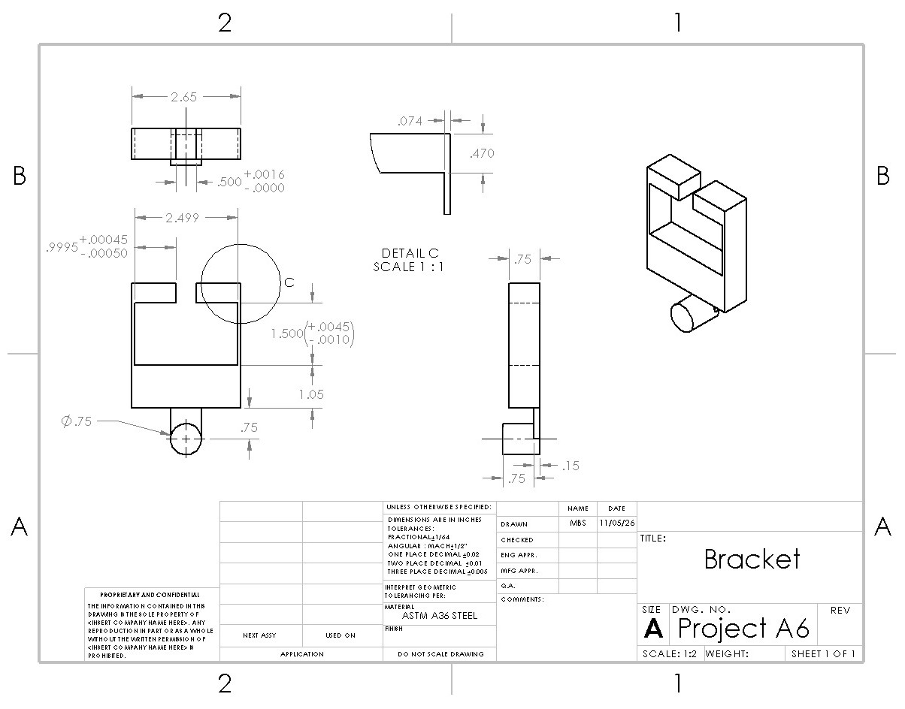

For the width of Feature C, the dimensions were made to the X.XXX and are a functional surface. Feature C width requires precision to the 3rd decimal place because the dimensions of a & b of the rigid body have to meet a certain clearance. However, for the diameter of Feature A, the dimensions were made to X.XX place and were a non-critical feature. The dimensions were made to be in the X.XX tolerance class in order to meet the minimum required cross-section to handle the load applied. 

Actual time it took from start to finish.
Have a Lessons Learned section

