# A7 – [FEA on Bracket]

## Objective

- Use Finite Element Analysis (FEA) to improve the bracket design from previous assignments.
- Ensure high stiffness, strength, and lightweight optimization through iterative design.
- Conduct multiple FEA simulations, refining geometry based on results.
- Perform static stress analysis, including constraints, loading, and meshing selection.
- Interpret data by identifying max stress, displacement, and safety factors.
- Optimize the design by modifying geometry to enhance performance.
- Document the entire process with images, calculations, and insights.
- Reflect on key engineering lessons learned and time spent.

## Analyze
The goal of this method is to modify the design to achieve the highest stiffness, strength, and lightest weight possible.

### Bracket

#### Design 1
Constraints were put on the bottom of feature E. Force was modeled as a the distributed mass of 1600 lbs.
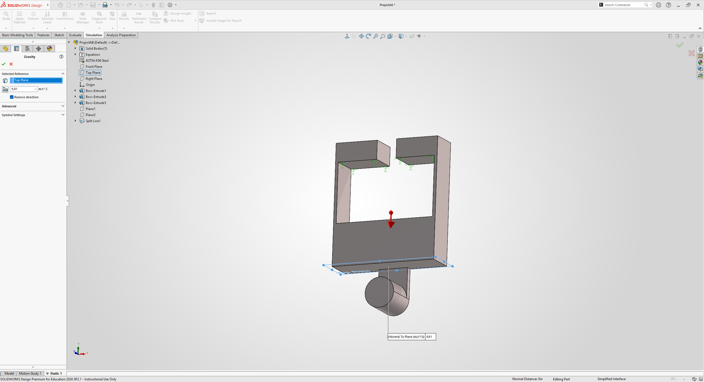

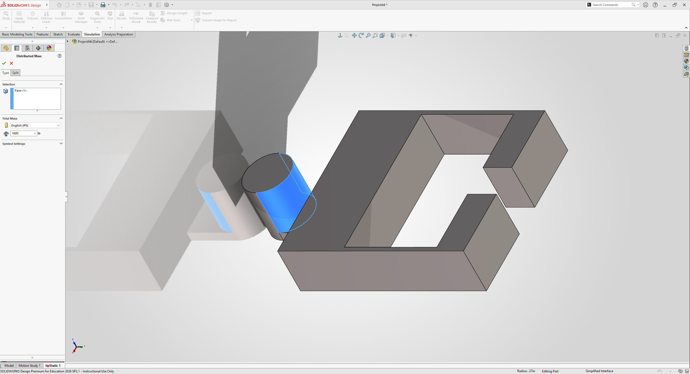

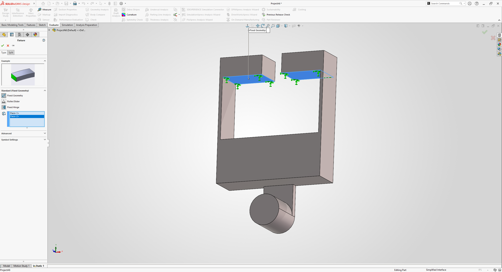

2 iterations and passed 7% convergence Check
Inner loop time: 1 hour 30 min
Stress significantly higher than expected. Feature B was not modeled accuratley and stresses were higher than expected.

**(Bracket) Design 1, Iteration 1**
- max stress: 269,500 psi
- max displacement: 0.08167 in
- min FOS: blank
- mass: 0.98 lbs
- number of elements: 1,347

**(Bracket) Design 1, Iteration 2**
- max stress: 278,300 psi
- max displacement: 0.08468 in
- min FOS: blank
- mass: 0.98 lbs
- number of elements: 2,977

**(Bracket) Design 1, Convergence Check**
- Stress %: 3.21
- Deflection %: 3.62
- Factor of Safety %: N/A

**(Bracket) Design 1, Iteration 3**
- max stress: 313,200 psi
- max displacement: 0.08869 in
- min FOS: N/A
- mass: 0.98 lbs
- number of elements: 15,296
  
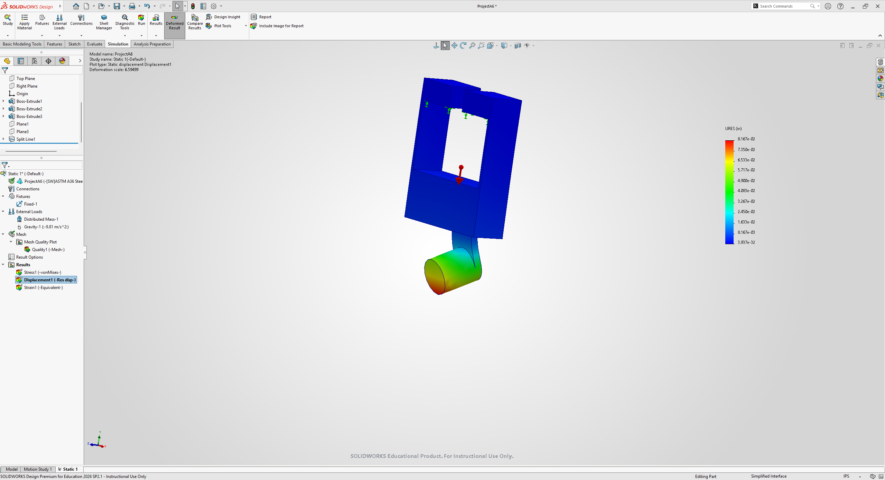

**Notes (max stress and displacement)**
- Iteration 1
  - Stress: Mid-point of feature B
  - Displacement: End of feature A/End of feature B
- Iteration 2
  - Stress: Mid-point of feature B stretching towards the corners of the interface of feature B&C. Stress concentration around the peak of feature A connecting to feature B.
  - Displacement: End of feature A/End of feature B
- Iteration 3
  - Stress: Stress concentration at corners of feature B attached to feature C and top of half circle of feature A
  - Displacement: End of feature A/End of Feature B

#### Design 2

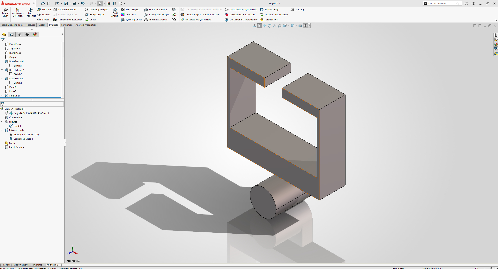

Required 3 iterations Failed in the same areas as design 1. Deflection behaved the same as desig1.Reduction in thickness of Feature C led to feature D experiencing more stress and deflecting more. Stress concentrations exceed ultimate strength of 58015 psi.
Design 2 redesign was able to reduce stress by 62.52% and deflection by 69.95%. This time a FOS study was done and was set to autometic.

**(Bracket) Design 2, Iteration 1**
- max stress: 101,000 psi
- max displacement: 0.02454 in
- min FOS: 0.36
- mass: 0.6 lbs
- number of elements: 2,397

**(Bracket) Design 2, Iteration 2**
- max stress: 127,600 psi
- max displacement: 0.02508 in
- min FOS: 0.36
- mass: 0.6 lbs
- number of elements: 9,105

**(Bracket) Design 2, Convergence Check**
- Stress %: 11.64
- Deflection %: 1.09
- Factor of Safety %: 0

**(Bracket) Design 2, Iteration 3**
- max stress: 135,700 psi
- max displacement: 0.02517 in
- min FOS: 0.27
- mass: 0.6 lbs
- number of elements: 15,708

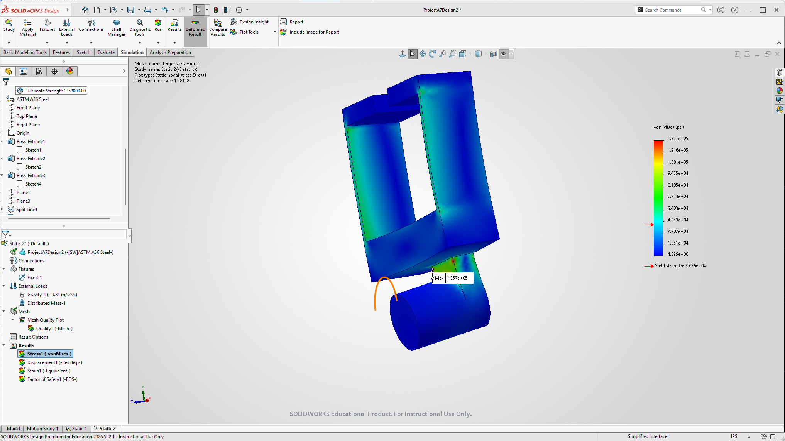

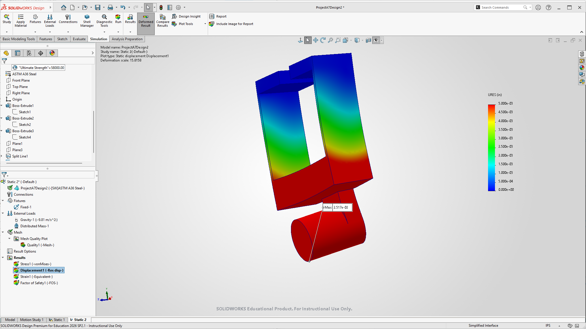

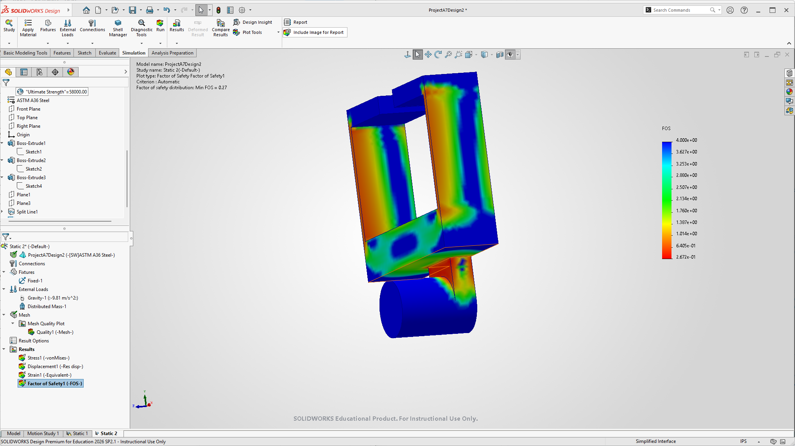

**Notes (max stress and displacement)**
- Iteration 1
  - Stress: Corners of front face connecting feature B to feature C.
  - Displacement: Tip of feature A, End of feature B.
- Iteration 2
  - Stress: Corners of front face connecting feature B to feature C.
  - Displacement: Tip of Feature A/End of feature B
- Iteration 3
  - Stress: Corners of front face connecting feature B to feature C.
  - Displacement: Tip of Feature A/End of feature B

#### Design 3

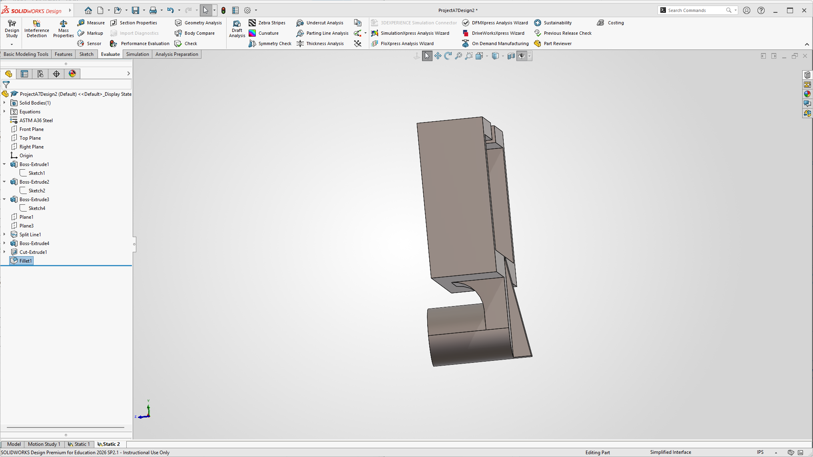

Design 3 had the same problems as design 2 and did not meet minimum deflection. Stress concentrated around the thinnest part of the fillet around the circumference of feature A where feature A & B interface. Additionally on the opposite side of the feature B stress concentrated around the same area. Maximum stress went down 26.94% and deflection reduced by 28.40% with max stress being 88120 psi, and max deflection being 0.01816 in. Lastly FOS increased by 36.111% to 0.49.

**(Bracket) Design 3, Iteration 1**
- max stress: 73,790 psi
- max displacement: 0.01757 in
- min FOS: 0.49
- mass: 0.61 lbs
- number of elements: 2,759

**(Bracket) Design 3, Iteration 2**
- max stress: 85,890 psi
- max displacement: 0.01795 in
- min FOS: 0.42
- mass: 0.61 lbs
- number of elements: 12159

**(Bracket) Design 3, Convergence Check**
- Stress %: 7.58
- Deflection %: 1.07
- Factor of Safety %: blank

**(Bracket) Design 3, Iteration 3**
- max stress: 88,120 psi
- max displacement: 0.01816 in
- min FOS: 0.42
- mass: 0.61 lbs
- number of elements: 23,286

**Notes (max stress and displacement)**
- Iteration 1
  - Stress: Towards the edges of the fillet around the circumference of feature A
  - Displacement: End of feature A/End of feature B
- Iteration 2
  - Stress: Mid-point of feature B stretching towards the edges of the fillet around the circumference of feature A.
  - Displacement: End of feature A/End of feature B
- Iteration 3
  - Stress: Mid-point of feature B
  - Displacement: End of feature A/End of feature B

#### Design 4

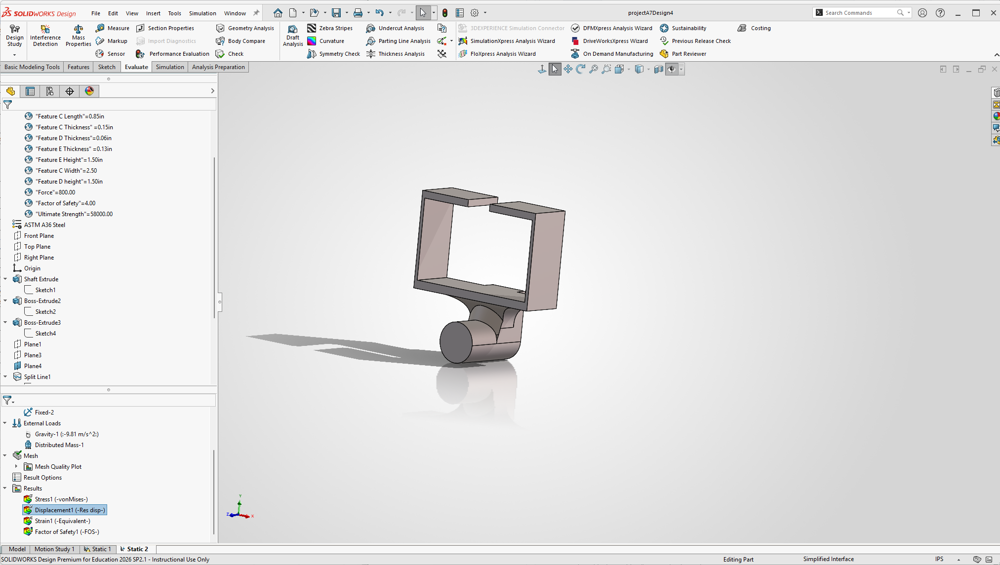

Passed convergence check after 2 iterations.
Design 4 saw a 54.36% decrease in max stress compared to design 3 with a max stress of 33330 psi located around the intersection of the chamfer and fillet of feature B. Maximum deflection decreased down to 0.1852. Mass was reduced down to 0.49 lbs. and a FOS of 1.1 was achieved. 

**(Bracket) Design 4, Iteration 1**
- max stress: 33,680 psi
- max displacement: 0.00184 in
- min FOS: 1.1
- mass: 0.49 lbs
- number of elements: 3,827

**(Bracket) Design 4, Iteration 2**
- max stress: 33,330 psi
- max displacement: 0.001852 in
- min FOS: 1.1
- mass: 0.49 lbs
- number of elements: N/A

**(Bracket) Design 4, Convergence Check**
- Stress %: -0.52
- Deflection %: 0.33
- Factor of Safety %: 0

**Notes (max stress and displacement)**
- Iteration 1
  - Stress: Towards the edges of the fillet around the circumference of feature A
  - Displacement: End of feature A/End of feature B
- Iteration 2
  - Stress: Mid-point of feature B
  - Displacement: End of feature A/End of feature B

### Bracket Link

#### Design 1

For the bracket link I designed both holes to be experiencing a bearing contact stress from a cylinder and modeled the fixtures as such. Original calculations did not account for interference and instead treated both holes as experiencing only bearing stress. However, the 1 in hole and shaft system should've been modeled with interference pressure and bearing stress from the strap. Using the formula from the lecture contact pressure I calculated to be ~35000 psi. Calculations for interference pressure were validated by Claude's, Google Gemini, and ChatGPT's answers. All three agreed on a contact pressure of 3545.46 psi contact pressure.

Entire surface of feature A's hole was fixed. Contact pressure and bearing stress were Applied to the entire circumference of the 1 in hole. 

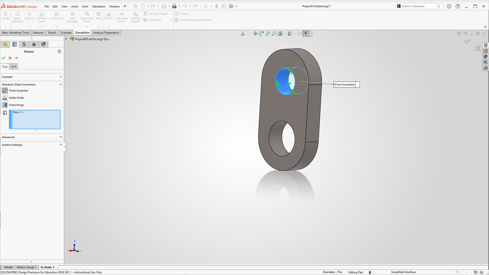

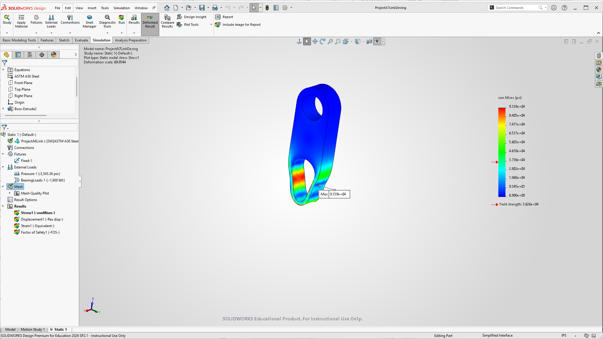

Design 1 experienced max stress of 93390 psi and a max deflection of 0.004698 in. Stress was concentrated around the sides of the 1 in hole interface and deflected the most towards the bottom of it. It experienced a minimum factor of safety of 1

Time taken: 1 hour 20 min

**(Link) Design 1, Iteration 1**
- max stress: 91,590 psi
- max displacement: 0.004634 in
- min FOS: 0.4
- mass: 0.37 lbs
- number of elements: 2,983

**(Link) Design 1, Iteration 2**
- max stress: 93,390 psi
- max displacement: 0.004698 in
- min FOS: 0.39
- mass: 0.37 lbs
- number of elements: 4,038

**(Link) Design 1, Convergence Check**
- Stress %: 1.95
- Deflection %: 1.37
- Factor of Safety %: -2.53

**Notes (max stress and displacement)**
- Iteration 1
  - Stress: Stress concentrated on the sides of the inner wall of 1 in hole.
  - Displacement: Bottom of 1 in hole.
- Iteration 2
  - Stress: Same area as iteration 1.
  - Displacement: Bottom of 1 in hole.

#### Design 2

Max stress experienced by the part dropped significantly by 76.31% and experienced a max stress of 22590 psi concentrated in the same areas of design 1 and deflected similarly to design 1. Significant weight increase to 0.66lbs occurred from uniformly increasing diameter around the link. 

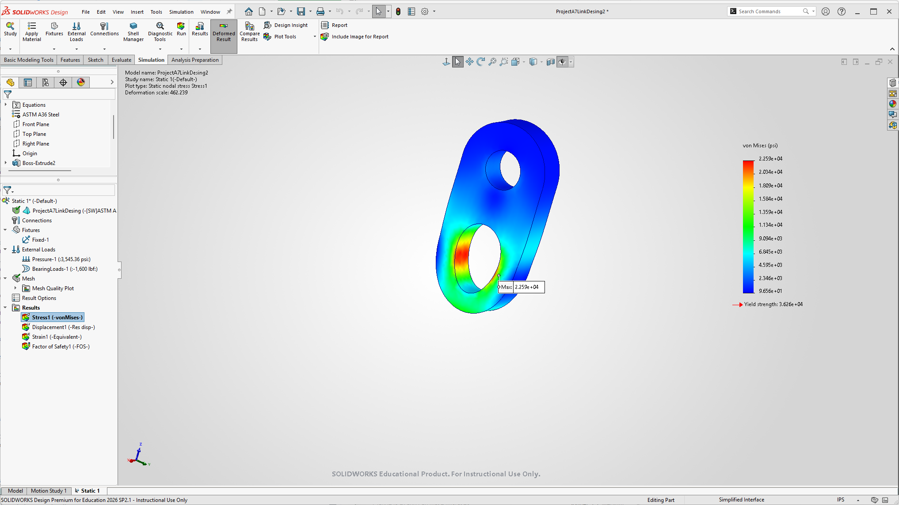

Time taken: 50 min
Convergence check passed with 2%

**(Link) Design 2, Iteration 1**
- max stress: 21,700 psi
- max displacement: 0.0007415 in
- min FOS: 1.671
- mass: 0.66 lbs
- number of elements: 2,122

**(Link) Design 2, Iteration 2**
- max stress: 22,590 psi
- max displacement: 0.0007444 in
- min FOS: 1.605
- mass: 0.66 lbs
- number of elements: 7,330

**(Link) Design 2, Convergence Check**
- Stress %: 2.01
- Deflection %: 0.20
- Factor of Safety %: -2.01

**Notes (max stress and displacement)**
- Iteration 1
  - Stress: Stress concentrations along the mid line of 1 in hole running from the front to the back of the link.
  - Displacement: Bottom of 1 in hole.
- Iteration 2
  - Stress: Stress concentrations along the mid line of 1 in hole running from the front to the back of the link.
  - Displacement: Bottom of 1 in hole.

### Design 3

Maximum stress was reduced down to 18540 psi with the same concentrations as previous design. 
Maximum deflection decreased to 0.0005989 in deflecting in the same region as previous design. 
FOS increased to 2.006.

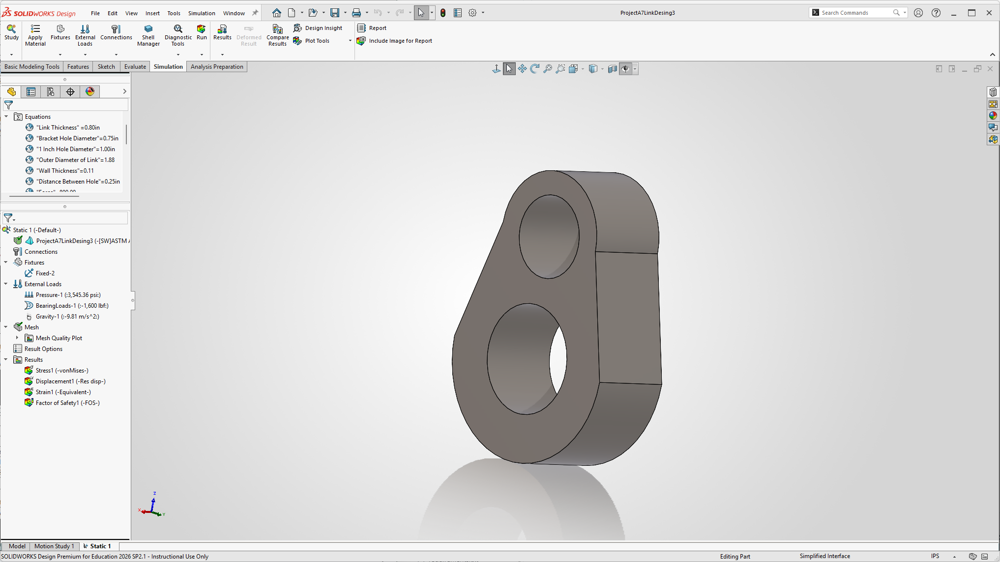

Time Taken: 1 hour 20 min

**(Link) Design 3, Iteration 1**
- max stress: 18,070 psi
- max displacement: 0.0005953 in
- min FOS: 2.006
- mass: 0.55 lbs
- number of elements: 2,759

**(Link) Design 3, Iteration 2**
- max stress: 18,540 psi
- max displacement: 0.0005989 in
- min FOS: 1.956
- mass: 0.55 lbs
- number of elements: 7,749

**(Link) Design 3, Convergence Check**
- Stress %: 1.28
- Deflection %: 0.30
- Factor of Safety %: -1.26

**Notes (max stress and displacement)**
- Iteration 1
  - Stress: Stress concentrations along the mid line of 1 in hole running from the front to the back of the link.
  - Displacement: Bottom of 1 in hole.
- Iteration 2
  - Stress: Stress concentrations along the mid line of 1 in hole running from the front to the back of the link.
  - Displacement: Bottom of 1 in hole.

### Design 4
All goals were met on Design 4. Maximum stress decreased to 0.4771 psi and concentrated around the midpoint of the hole of feature A. Maximum deflection decreased significantly to 1.308 nano in and displaced the most outside the outer diameter of feature A. FOS increased to 15 and met the minimum factor of safety required.

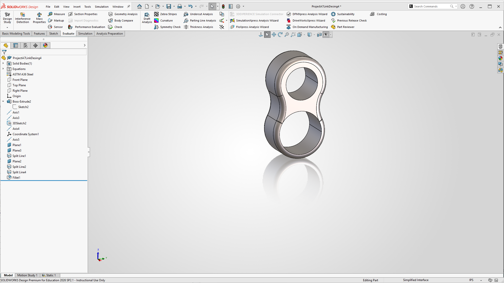

Time Taken: 3 Hours

**(Link) Design 4, Iteration 1**
- max stress: 0.2709 psi
- max displacement: 0.000000001266 in
- min FOS: 15
- mass: 0.25 lbs
- number of elements: 3,672

**(Link) Design 4, Iteration 2**
- max stress: 0.331 psi
- max displacement: 0.000000001292 in
- min FOS: 15
- mass: 0.25 lbs
- number of elements: 7,134

**(Link) Design 4, Convergence Check**
- Stress %: 9.99
- Deflection %: 1.02
- Factor of Safety %: blank

**(Link) Design 4, Iteration 3**
- max stress: 0.4771 psi
- max displacement: 0.000000001308 in
- min FOS: 15
- mass: 0.25 lbs
- number of elements: 23799

**Notes (max stress and displacement)**
- Iteration 1
  - Stress: In the middle of the hole of feature A peaking towards the fillet
  - Displacement: At the bottom of feature A hole where it connects to the top of the 1 in hole.
- Iteration 2
  - Stress: A line through the mid-point of feature A hole al (text is cut off in the source sheet)
  - Displacement: Greatest displacement along the midpoint of the outer diameter of feature A
- Iteration 3
  - Stress: no note
  - Displacement: no note

## Decide

#### Bracket

### Design 1 Redesign

Initially Feature B was modeled inaccurately as a rod in tension. To properly gauge thickness feature B was thought of as a cantilever beam with moment applied to the free end.

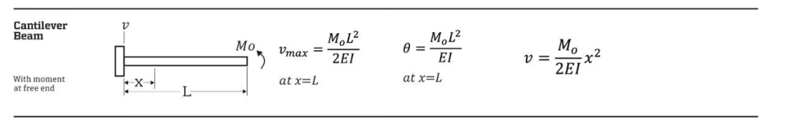

Based on the deflection equation I chose to increase thickness and decrease the length of feature B to minimize deflection & lower stress. Increase in feature B's thickness exponentially increases moment of inertia in turn significantly decreasing deflection of beam. Thickness was increased 100% and length was reduced 25% and should reduce deflection by 92.97%. Increased section moduli and a shorter beam length also reduce stress by 85.94%

To minimize mass I opted to reduce the thickness of feature C & E by 50% of its original length.

Constraints and forces were not changed.

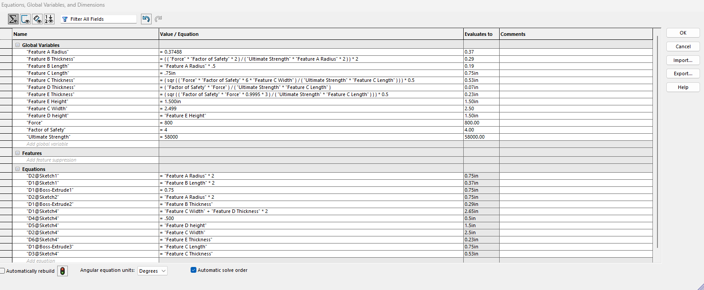

Time spent: 50 min

### Design 2 Redesign
In order to better distribute the load throughout the bracket and reduce the deflection on the end of the tip, I opted to add a rib connecting the bottom of feature A up to the top face feature C. The thickness of the rib was set to have the same thickness as feature C. The angle was set 10 degrees in order to minimize mass and still provide stiffness.

To minimize stress experienced by feature D and reduce deflection, thickness was increased by 0.1 in, and length of bracket was increased by 0.1 in. Additionally I opted to add a symmetric fillet connecting the bottom face of feature C to the front face of feature B to reduce the stress concentration where feature B connects to feature C. 

To conserve mass feature C's thickness was reduced by 0.20 in.

Time Spent: 50 min

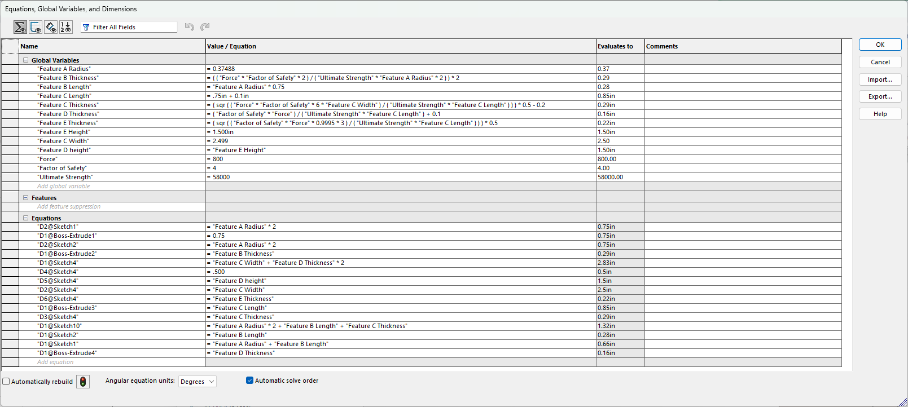

### Design 3 Redesign

To better distribute stress concentration around feature B radius of fillet added in design 3 increased to connect to the front face of the bracket with additional fillets added to the side. Added fillets reach from feature B's right and left hand side to the outside of the bracket. 
To reduce stress concentrations on the back of feature B and minimize deflection rib added in design 3 was removed and replaced by an extrusion of 0.25 in of the back face where feature A,B and C connect. Width of the feature was limited by the width of feature B to reduce mass gain. Lastly Chamfer was added around circumference of feature A connecting to feature B.

Feature E, D, and C's thickness was reduced to reduce mass.

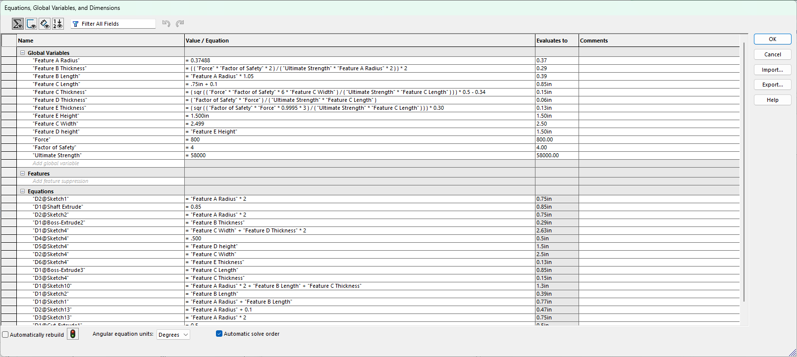

To model the forces experienced by the bracket more accurately I fixed the top of feature C along with the bottom face of feature E. 

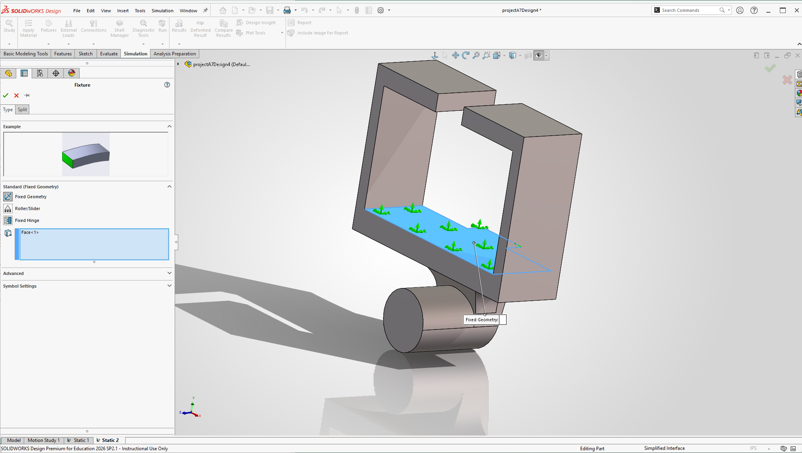

Time Spent: 1 hour 20 min

### Bracket Link

#### Design 1 Redesign
1 in hole failed before transmitting load to the rest of the link. More material needs to be added to the 1 in hole and to conserve weight distance between holes was set to a fixed length of 0.75 in. Outer diameter of hole was increased to 1.81in to better handle the stress concentrations and minimize the deflection of the from the bottom.

Thickness of link was kept the same to conserve mass. Additionally constraints and applied loads were kept the same in order to observe any changes to stress distribution.

Time spent: 40 min

#### Design 2 Redesign
Constraints were not changed from previous iteration to optimize for designed load.

To reduce mass I decreased the wall thickness around the hole of feature A to the original 1.20 in diameter, in addition to decreasing the spacing between holes to 0.25 in.

Thickness was recalculated with contact pressure from interference in addition to applied load. To better distribute stress concentrations around the inside surface of the 1 in hole thickness of the link was increased by 0.256 in from hoop stress calculation of 1 in hole.  

Additionally the ultimate strength variable was replaced with yield strength of the part to increase the FOS of the link.

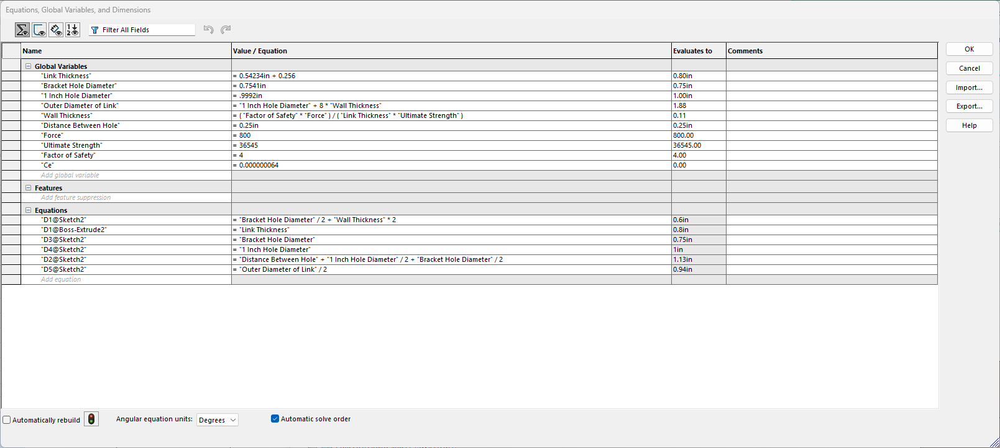

Time Spent: 1 hour

### Design 3 Redesign

Loads placed on 1" hole diameter were changed to a uniformly distributed load directed away from feature A and towards the 1 in hole  contacting only the bottom half of the surface. This was done to model load applied to the 1 in shaft with more accuracy.

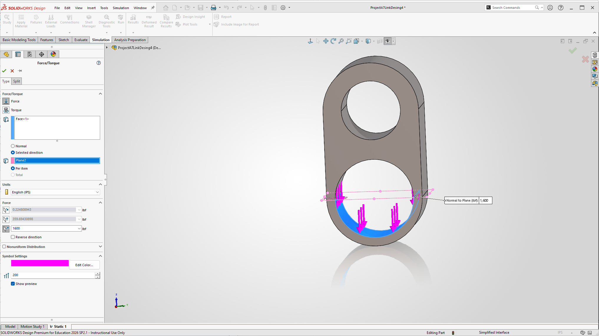

Additionally constraints were placed on the entire surface of the 1 in hole considering the press fitted pin strongly resists deformation of the hole. Feature A's constraints were modified to fix the only top half of the surface of the hole contacting feature A. Considering the small clearance of the running fit the bottom half of the hole of feature A would not make contact with the shaft and would be free to move around.

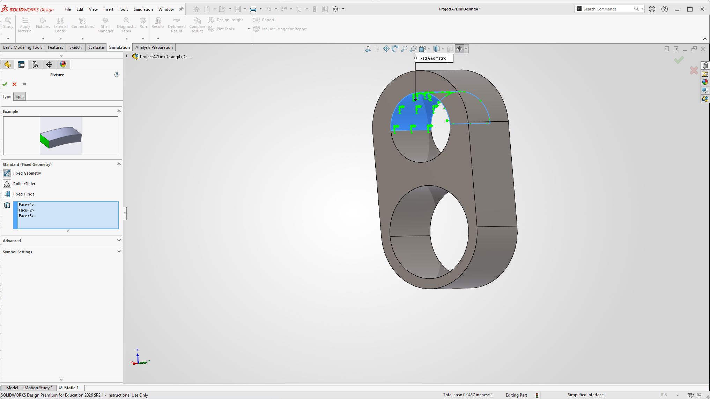

To reduce mass of the link outer diameter was reduced down to  1.22 in and dimensioned to both of the links outer diameter. Additionally fillets with a radius equal to wall thickness were added to the front and back faces of the link. Lastly sketch was modified to cut out material from the space between the links.

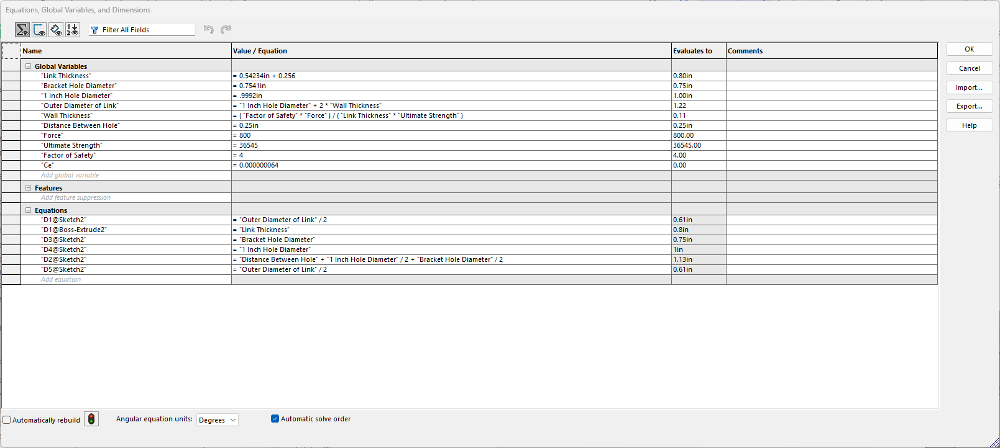

Time Spent: 1 hour 40 mins

## Communicate

Time spent on FEA: 12 Hours
Time spent on Documentation: 4 Hours

#### Reflection

Working on this assignment I learned that you can have correct calculations from poorly modeled problems. From FEA I learned that laying down the correct constraints and loads has a greater impact on stress and deflections compared to optimizing geometry. I learned that higher mesh counts are able to more accurately depict stress concentrations and where they occur. I learned that structuring the approach to any kind of analysis saves you time from having to organize your work. FEA can only help you optimize for only one set of constraints and applied loads.

#### Links to Final Design of parts

- Bracket 3: https://drive.google.com/file/d/12l8antniPuxIdXACS5OrWOCKRAcGJWWE/view?usp=sharing
- Bracket 4: https://drive.google.com/file/d/17HQBk8nxrFzp8-IhcIAzam1sA52BWZEd/view?usp=sharing 
- Link 3: https://drive.google.com/file/d/1h7J9XQkMWZm3U3GuXcDyKwTzK1gr1LT6/view?usp=sharing
- Link 4: https://drive.google.com/file/d/1uLcdxBusgoumxTZpC1S0A9KhxxlhCB7S/view?usp=sharing

#### Prompts used
- what is the contact pressure of a shaft and hole with an interference of 0.0008 in, a hub with an outer diameter of 1.2 in, a 1 in shaft, and a hole sized to 0.9992 in. Both shaft and hole are made of the same material with an elastic modulus of 29007457 psi.
